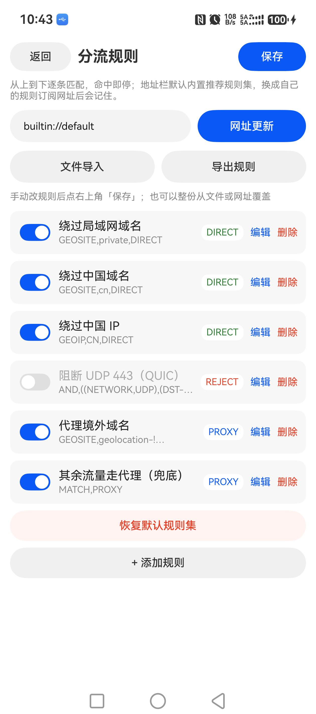

# v2rayNG 鸿蒙版

把 Android 上 [v2rayNG](https://github.com/2dust/v2rayNG) 的使用习惯搬到 HarmonyOS 上的原生客户端：
**ArkTS 界面 + mihomo（Go）内核 + NAPI 桥接 + 系统 VPN 扩展**，不是套壳 WebView，也不依赖任何第三方 VPN App。

> **非官方项目。** 本项目与 v2rayNG、mihomo 项目及其作者没有隶属关系，是个人在鸿蒙平台上的一次移植实践，
> 借用的是它们的设计思路、内核与协议实现。上游致谢见 [CREDITS.md](CREDITS.md)。

## 界面

| 分流规则面板 | 规则分页（社区大规则集） | 左侧抽屉 |
| --- | --- | --- |
|  |  |  |

## 功能

**节点与订阅**

- 订阅链接按「一次导入」自动分组：手动节点一组，每个订阅链接各成一组，大组默认折叠，可单独「更新 / 测速」
- 支持订阅链接导入、单条链接批量粘贴（`vmess://` `vless://` `ss://` `trojan://`，一行一个）、剪贴板导入
- 节点可编辑 / 删除，支持手动添加

**测速与选节点**

- 并发 16 条测速，顶部实时显示「已测 / 待测」进度
- 测速是**本机直连节点**做 TCP 握手 + 首字节探测（不先拉起代理，也不走 TUN），所以拖动代理开关不影响结果
- 测完按延迟从低到高排序，超时/失败的沉底
- **点哪个节点，蓝色对勾立刻落在那一行**：只重绘这一行，不重建整张列表
- 已连接状态下点选节点即切过去：手停 0.8 秒后自动断开重连，状态栏依次显示「准备切换到 …」「正在切换节点…」，
  全程约 5 秒；连点几下只切最后选中的那个
- 列表走 `LazyForEach` 懒加载，392 条节点时点选只刷新两行，滚动不掉帧
- **不会替你挑节点**：切哪个由你自己点

**操作与布局**

- 订阅、导入、设置收进左侧抽屉（约 72% 宽），主页面只留节点列表，不乱
- 底部一整行 50vp 的代理开关（未连接蓝底「开启代理」/ 已连接红底「停止代理」），单手可点

**分流规则（设置 → 分流规则）**

- 手动增删改、单条启停、`DIRECT / PROXY / REJECT` 目标点一下就轮换
- `rules.json` 持久化，连接状态下改完自动重连生效
- 文件导入 / 导出（JSON 或 Clash 规则片段）
- 网址订阅更新：一份地址整份覆盖，支持两种格式
  - 本项目的规则 JSON
  - **社区 rule-provider 的 payload 纯清单**（Loyalsoldier/clash-rules、ACL4SSR 那种一行一个域名的格式），
    域名自动判 `DOMAIN-SUFFIX`、CIDR 自动判 `IP-CIDR`/`IP-CIDR6`，方向按地址或文件名里是否含
    `direct`/`private`/`china`/`reject`/`ban` 推断
- 大清单每屏只渲染 50 条，「再显示 50 条（共 N 条）」逐页展开
- 地址栏默认内置规则集（`builtin://default`，点「网址更新」直接应用内置 6 条，永不失效）；
  换成的自定义地址会记在 `rules-src.txt`，下次打开自动回填；删空后点「保存」就回落到默认

**默认 6 条规则**（对齐 v2rayN 的路由语义）

| 规则 | 目标 | 默认状态 |
| --- | --- | --- |
| `GEOSITE,private` | DIRECT | 开 |
| `GEOSITE,cn` | DIRECT | 开 |
| `GEOIP,CN` | DIRECT | 开 |
| `AND,((NETWORK,UDP),(DST-PORT,443))` | REJECT | 关 |
| `GEOSITE,geolocation-!cn` | PROXY | 开 |
| `MATCH` | PROXY | 开 |

## 架构

```
┌──────────────────────────────────────────────┐
│ ArkTS UI（pages/Index.ets，单文件页面）        │
│  ├ 节点列表 / 测速 / 抽屉 / 分流规则面板        │
│  └ core/ConfigBuilder.ets  生成 mihomo 配置    │
├──────────────────────────────────────────────┤
│ EntryAbility  ←→  VpnExtAbility（VPN 扩展）    │
│  系统 TUN fd  ──►  内核接管                    │
├──────────────────────────────────────────────┤
│ NAPI 桥（cpp/napi_init.cpp → libngnapi.so）    │
│  dlopen libngcore.so，双向回调（protect/socket）│
├──────────────────────────────────────────────┤
│ Go 内核（core-native/main.go + mihomo v1.19.33）│
│  出站 socket 交回 ArkTS 做 protect，绕开回环    │
└──────────────────────────────────────────────┘
```

几个关键决定：

- **内核不自己 open socket 就完事**：鸿蒙的 `VpnConnection.protect()` 只接受 `@ohos.net.socket` 建的 fd，
  Go 自己开的 socket 会被 netmanager 拒绝，所以内核出站前回调到 ArkTS 侧做 protect（NAPI 异步 + 文件桥，避免死锁）
- **同步 NAPI 里不能回调 ArkTS**（会死锁），protect 链路因此做成异步
- 内核日志通过 NAPI 挂到 `hilog`，标签 `NG-CORE`，`hdc hilog | grep NG-CORE` 就能看

## 目录结构

```
app/                            鸿蒙工程（hvigor / ArkTS）
  entry/src/main/ets/
    pages/Index.ets             单文件主界面（节点、测速、抽屉、规则面板）
    core/ConfigBuilder.ets      mihomo 配置生成 + 规则解析（含 payload 清单兼容）
    core/ProxyLink.ets          节点链接解析
    core/FileStore.ets          数据落盘
    core/Model.ets              数据结构
    entryability/EntryAbility.ets
    vpnextability/VpnExtAbility.ets   VPN 扩展，TUN fd 与 protect 处理
  entry/src/main/cpp/           NAPI 桥（napi_init.cpp）
  entry/libs/arm64-v8a/         预编译内核库与 NAPI 库
  entry/src/main/resources/rawfile/   内置节点示例、geo 数据
core-native/                     Go 内核桥接（mihomo 依赖）
tools/                          命令行构建脚本
```

## 构建

**前置**

- OpenHarmony SDK（`compileSdkVersion 15`，`compatibleSdkVersion 12`），DevEco Studio 或纯命令行均可
- Node.js 18+ 与 hvigor（`app/package.json` 里已锁定依赖）
- JDK 17（hvigor 需要）
- 只有需要重编内核时才需要 Go 1.24+ 与 OpenHarmony Go 交叉工具链

**1. 准备环境文件**

```powershell
cd app
Copy-Item local.properties.example local.properties   # 改成你本机 SDK 路径
npm install
```

**2. 准备内置节点（可选）**

`entry/src/main/resources/rawfile/nodes.txt` 不入库（里面是私人节点）。要用内置节点就：

```powershell
Copy-Item entry/src/main/resources/rawfile/nodes.txt.example entry/src/main/resources/rawfile/nodes.txt
# 然后把里面的示例链接换成你自己的，或者直接不建这个文件
```

**3. 准备 geo 数据（可选，但分流规则需要）**

`geoip.dat` / `geosite.dat` 不入库（约 28MB，来自 [Loyalsoldier/v2ray-rules-dat](https://github.com/Loyalsoldier/v2ray-rules-dat)）。
把它们放到 `app/entry/src/main/resources/rawfile/` 即可；缺这两个文件时 `GEOSITE`/`GEOIP` 规则不生效。

**4. 编译内核库（仓库已附带预编译产物，可跳过）**

`entry/libs/arm64-v8a/libngcore.so` 是 mihomo 交叉编译出来的 `c-shared` 库，运行时 dlopen 加载。
仓库里已经带了一份；要自己重编，用 Go 配合 NDK clang 交叉编译：

```powershell
# 关键点：GOOS=linux、GOARCH=arm64、CGO_ENABLED=1，CC/CXX 指向 NDK 的 clang
# 并在 core-native 目录执行 c-shared 构建，产物复制到 app/entry/libs/arm64-v8a/libngcore.so
```

NAPI 库（`libngnapi.so`）也可以用脚本重编：

```powershell
$env:OHOS_SDK = "你的 SDK 根目录"
pwsh .\tools\build-napi.ps1
```

**5. 构建 HAP**

```powershell
$env:OHOS_SDK  = "你的 SDK 根目录"
$env:JAVA_HOME = "你的 JDK 17 目录"
pwsh .\tools\build-hap.ps1
```

产物在 `app/entry/build/default/outputs/default/`，未签名。

**6. 签名与装机**

用 DevEco Studio 的自动签名，或自己准备 `p12 / cer / p7b` 后调用 `hap-sign-tool`：

```powershell
java -jar hap-sign-tool.jar sign-app -keyAlias "..." -signAlg "SHA256withECDSA" `
  -mode "localSign" -appCertFile "xxx.cer" -profileFile "xxx.p7b" `
  -inFile "entry-default-unsigned.hap" -keystoreFile "xxx.p12" -outFile "entry-default-signed.hap" `
  -keyPwd "..." -keystorePwd "..." -signCode "1"
hdc install -r entry-default-signed.hap
```

## 更新记录

- **本轮**：节点列表改为 `LazyForEach` 懒加载（修掉「测速完不排序」「点一下卡十几秒」）；点选节点只重绘两行、
  蓝色对勾即时落在点击行；已连接时点选节点自动切换（0.8 秒防抖）；连接/断开与切换全程有状态文案，按钮在过程中置灰
- 早期：VPN 状态以系统实际存在为准（修「图标消失但界面显示已连接」）、断开/重连改成轮询等通道消失、
  左滑露出编辑/删除、分流规则面板与社区 payload 兼容、全站字号放大

## 已知限制

1. 国内 UDP 直连偶发 `netlinkrib: permission denied`（`[UDP] ... DIRECT`），TCP 正常，走 QUIC 的应用会自动回落 TCP
2. 订阅导入不解析 `sub-userinfo`（流量 / 到期信息）
3. 同一订阅 URL 不同写法（结尾斜杠、大小写、query 变化）会被当成两个分组
4. 文件导入的「选文件 → 读取 → 覆盖」链路在自动化环境里没跑通端到端（系统文件选择器不接收注入），需人工点一次确认
5. 不自动挑选「最优节点」（有意为之，节点由你自己选）；已连接时点选节点才会自动切过去，只是想浏览就先停掉代理
6. 只有一个 `arm64-v8a` 的预编译内核库，其它 ABI 需自行编译

## 免责声明

本项目仅供学习与研究 HarmonyOS 上的网络代理客户端实现，不提供任何节点、订阅或服务。
使用者需自行确保其使用行为符合所在地法律法规与所在网络的服务条款。作者不对使用后果承担责任。

## 致谢

本项目站在这些开源项目肩膀上，详细来源与许可见 [CREDITS.md](CREDITS.md)：

- **[2dust/v2rayNG](https://github.com/2dust/v2rayNG)** — 界面结构与交互参考（分组、测速、路由设置）
- **[2dust/v2rayN](https://github.com/2dust/v2rayN)** — 分流规则语义与「路由设置」面板的参照
- **[MetaCubeX/mihomo](https://github.com/MetaCubeX/mihomo)** — 网络内核，本项目以 Go module `v1.19.33` 依赖并交叉编译为 `libngcore.so`
- **[Loyalsoldier/v2ray-rules-dat](https://github.com/Loyalsoldier/v2ray-rules-dat)** — `geoip.dat` / `geosite.dat` 数据来源（未随仓库分发，自行下载）
- **[Loyalsoldier/clash-rules](https://github.com/Loyalsoldier/clash-rules)** — rule-provider payload 清单格式的兼容目标
- **[ACL4SSR/ACL4SSR](https://github.com/ACL4SSR/ACL4SSR)** — 社区规则集格式与命名习惯的参照
- **[v2fly/domain-list-community](https://github.com/v2fly/domain-list-community)** — geosite 数据的上游
- **OpenHarmony SDK / hvigor** — 构建与运行环境（不随仓库分发）

## 许可

[GNU General Public License v3.0](LICENSE)（与 mihomo、v2rayNG 上游一致）。分发衍生作品时请保留同样的许可与致谢。
